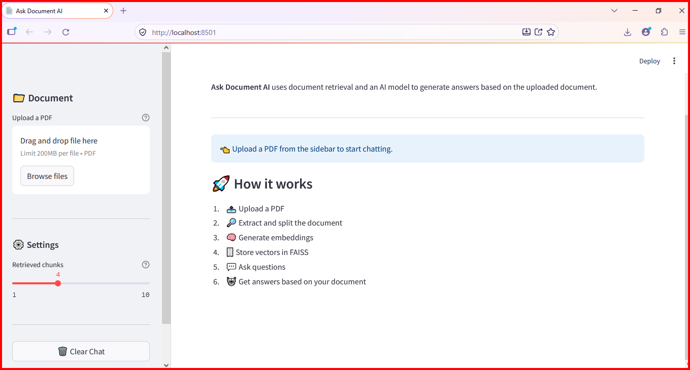
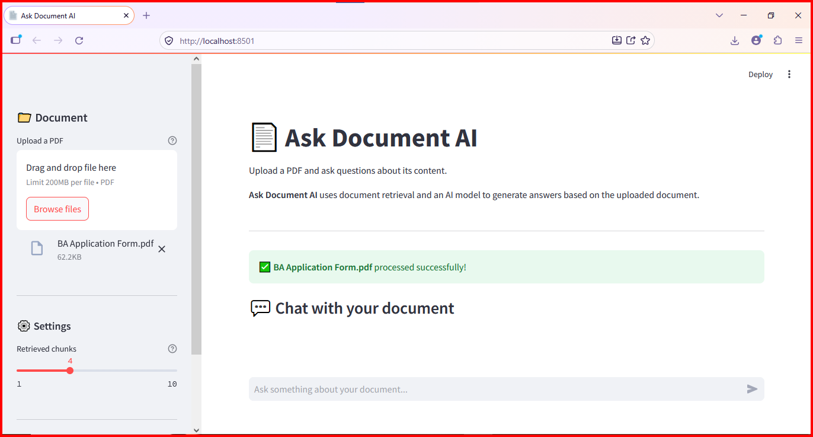
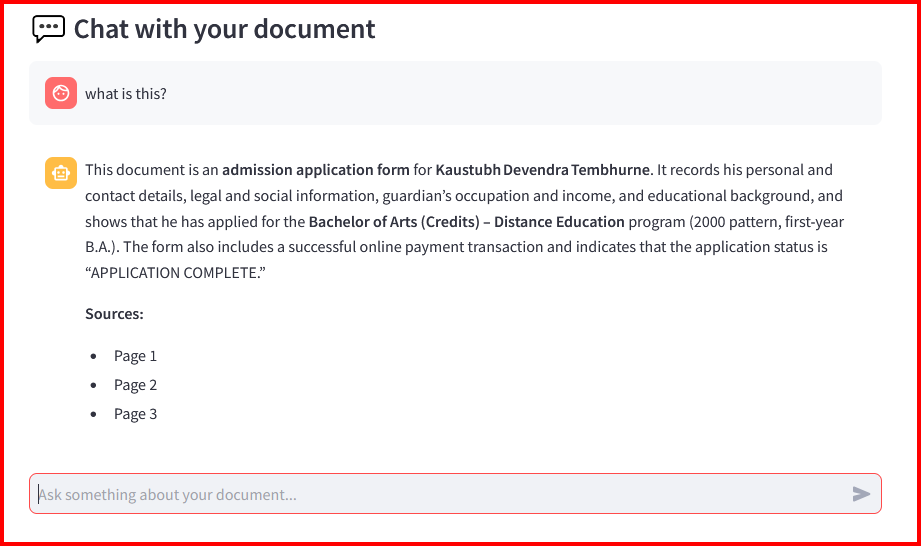

# 📄 Ask Document AI — PDF Question Answering Chatbot

An AI-powered **PDF question-answering chatbot** that allows users to upload documents and ask questions about their content using natural language.

Built with **Python, Streamlit, LangChain, Hugging Face Sentence Transformers, FAISS, and Groq**, this application uses Retrieval-Augmented Generation (RAG) to retrieve relevant document context and generate context-aware answers.

## 🎞 Live Demo

🚀 **[Try Ask Document AI](https://ask-document-pdf-chatbot-otdrljsldvgfe3jxm8qhu5.streamlit.app/)**

## 📸 Application Screenshots

### 1. Application Interface



### 2. PDF Document Upload



### 3. Chat and AI Response



### 4. Source References


> Screenshots demonstrate the application's actual interface and implemented features.

## ✨ Features

- 📄 Upload PDF documents
- 📖 Extract text and document metadata
- ✂️ Split text into smaller, manageable chunks
- 🧠 Generate semantic embeddings using Hugging Face Sentence Transformers
- 🔎 Perform similarity search using FAISS
- 🤖 Generate document-grounded answers using a Groq-powered LLM
- 💬 Interactive Streamlit chat interface
- 🗂️ Maintain conversation history during the current session
- ⚙️ Configure the number of retrieved document chunks
- 📑 Display relevant source pages when available
- 🔐 Manage API keys through environment variables
- 🧪 Automated testing with Pytest
- 🧩 Modular and maintainable architecture

## 🛠️ Tech Stack

| Technology | Purpose |
|---|---|
| Python | Core application logic |
| Streamlit | Interactive web interface |
| LangChain | Document processing and RAG components |
| Hugging Face Sentence Transformers | Text embeddings |
| FAISS | Vector similarity search |
| Groq | LLM-powered answer generation |
| PyPDF | PDF text extraction |
| python-dotenv | Environment variable management |
| Pytest | Automated testing |

## 🏗️ Project Structure

```text
AskDocument-PDF-Chatbot/
│
├── app.py
├── requirements.txt
├── README.md
├── .env
├── .env.example
├── .gitignore
│
├── config/
│   ├── __init__.py
│   └── settings.py
│
├── data/
│   ├── uploads/
│   └── vectorstore/
│
├── screenshots/
│   ├── app-home.png
│   ├── pdf-upload.png
│   ├── chat-response.png
│   └── source-citations.png
│
├── src/
│   ├── __init__.py
│   ├── chatbot/
│   │   ├── __init__.py
│   │   ├── chatbot.py
│   │   ├── prompts.py
│   │   └── response_handler.py
│   │
│   ├── document/
│   │   ├── __init__.py
│   │   ├── loader.py
│   │   └── splitter.py
│   │
│   ├── embeddings/
│   │   ├── __init__.py
│   │   └── embedder.py
│   │
│   ├── vectorstore/
│   │   ├── __init__.py
│   │   └── faiss_store.py
│   │
│   └── utils/
│       ├── __init__.py
│       ├── logger.py
│       └── validators.py
│
└── tests/
    ├── __init__.py
    ├── test_loader.py
    ├── test_splitter.py
    ├── test_embeddings.py
    └── test_rag.py
```

> This structure documents the intended organization. Keep it synchronized with the files actually present in your repository.

## ⚙️ Setup Instructions

### Prerequisites

Make sure you have the following installed:

- Python 3.11 or another Python version supported by your dependencies
- Git
- Visual Studio Code (recommended)
- A Groq API key

### 1. Clone the repository

Replace the example URL below with your actual GitHub repository URL.

```bash
git clone YOUR_GITHUB_REPOSITORY_URL
cd AskDocument-PDF-Chatbot
```

Alternatively, download the repository as a ZIP file and extract it.

### 2. Create a virtual environment

**Windows — PowerShell**

```powershell
python -m venv venv
.\venv\Scripts\Activate.ps1
```

If PowerShell blocks activation, you can use Command Prompt instead:

```bat
venv\Scripts\activate.bat
```

### 3. Install dependencies

```bash
python -m pip install --upgrade pip
pip install -r requirements.txt
```

### 4. Configure environment variables

Create a `.env` file in the project root directory.

Add your Groq API key:

```env
GROQ_API_KEY=your_groq_api_key_here
```

Replace the placeholder with your actual API key.

You can obtain an API key from the [Groq Console](https://console.groq.com/).

**Security:** Never commit your real `.env` file or API key to GitHub. Use `.env.example` to document the required variable without exposing secrets.

Example `.env.example`:

```env
GROQ_API_KEY=your_groq_api_key_here
```

If your application uses additional environment variables, add their names to `.env.example` as well.

### 5. Run the application

From the project root directory, run:

```bash
streamlit run app.py
```

Streamlit will display a local URL, usually:

```text
http://localhost:8501
```

Open that URL in your browser.

## 🚀 How to Use

1. Open the application.
2. Upload a supported PDF document.
3. Wait for the document to be processed and indexed.
4. Enter a question about the uploaded document.
5. Review the AI-generated answer.
6. Check source-page references when available.
7. Ask follow-up questions within the current session.

**Tip:** Questions that are specific to the uploaded document generally produce more useful results.

## 🔄 How It Works

The application follows a Retrieval-Augmented Generation (RAG) pipeline.

```text
PDF Upload
    ↓
Document Loading
    ↓
Text Extraction
    ↓
Text Chunking
    ↓
Embedding Generation
    ↓
FAISS Vector Store
    ↓
Similarity Search
    ↓
Relevant Context Retrieval
    ↓
Groq LLM
    ↓
Answer + Source References
```

### Pipeline Overview

1. **Document loading:** Extracts text and metadata from the PDF.
2. **Text splitting:** Divides extracted text into smaller chunks.
3. **Embedding generation:** Converts text chunks into numerical vector representations.
4. **Vector indexing:** Stores embeddings in FAISS.
5. **Retrieval:** Finds document chunks relevant to the user's question.
6. **Answer generation:** Passes the retrieved context and question to the Groq-powered LLM.
7. **Source references:** Displays relevant document pages when metadata is available.

## 🧪 Running Tests

Activate your virtual environment and run:

```bash
pytest -v
```

To run a specific test module:

```bash
pytest tests/test_loader.py -v
```

To generate a test coverage report, first install the optional coverage package:

```bash
pip install pytest-cov
```

Then run:

```bash
pytest --cov=src --cov-report=term-missing
```

These commands assume the corresponding tests exist and are compatible with the project's current implementation.

## 🔐 Security and Best Practices

- Store secrets in environment variables.
- Keep `.env`, virtual environments, caches, and temporary uploaded files out of version control.
- Validate uploaded files before processing.
- Handle invalid, empty, or unreadable PDFs gracefully.
- Avoid logging API keys or sensitive document contents.
- Do not commit private or confidential PDFs.

## 🚧 Future Improvements

- [ ] Support multiple PDF uploads
- [ ] Persistent vector storage
- [ ] Persistent conversation memory
- [ ] Improved source and page citations
- [ ] Streaming responses
- [ ] Document preview
- [ ] Authentication and access control
- [ ] Improved retrieval and reranking
- [ ] OCR support for scanned PDFs
- [ ] Support for additional document formats

## 🎯 Project Goal

The goal of this project is to demonstrate a modular RAG application that combines document ingestion, semantic search, vector retrieval, and LLM-based answer generation.

The project emphasizes clean architecture, secure configuration, error handling, testing, and a practical user interface.

## 👨‍💻 Author

**Nirbhay Tembhurne**

Python Developer | AI Chatbots | AI Integration | AI Automation

---

⭐ If you find this project useful, consider giving the repository a star.
